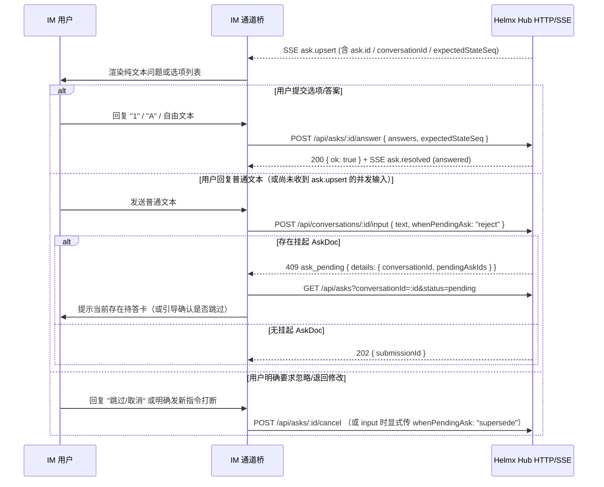

# AskDoc 文本通道与 IM 桥接入指南

本文面向 IM 桥、Bot 适配器与无卡片 UI 消费端的开发者：说明如何在纯文本通道中无竞态地接入 `AskDoc`（含内核 `ask_user` 提问与插件审批，如 `builtin:plan` 的 `plan_propose`）、映射 5 类表单字段、解析 `LocalizedText` 多语言文案，以及守住 CAS 水位线与权限红线。

## 架构职责边界

Helmx 采用**机制与策略分离**：

- **内核（`@helmx/kernel`）只负责通用机制**：`AskDoc` 生命周期持久化、阻塞状态（`blocked`）、乐观锁 CAS 水位校验、`whenPendingAsk: 'reject'` 原子防撞守卫，以及全权限边界与脱敏。内核**不**猜自由文本答案，也**不**内置多轮表单采集状态机。
- **通道适配器（IM 桥）负责交互策略**：订阅 SSE 与查询待答列表、把 `AskSpec` 渲染成纯文本消息、收集用户输入并映射为强类型 `AskAnswers`、调用 `POST /api/asks/:id/answer` 或 `cancel`。

这样同一会话同时被 Web 工作台与 IM 桥使用时，不会出现协议分裂，也不会把无关的普通聊天消息误判为 `answered`。

---

## 无竞态交互协议（必读）

不要用“内存缓存猜测有没有待答卡”或直接裸调 `POST /api/conversations/:id/input`（默认策略 `whenPendingAsk: 'supersede'` 会立即作废同会话待答卡）。推荐按以下闭环实现：



### 关键接口

1. **实时订阅与断线恢复**：连接 `GET /api/events` SSE（记录 `bootId` 与 `seq`，重连携带 `?afterSeq=&bootId=`）；桥进程冷启动或重连回退全量时，通过 `GET /api/asks?conversationId=<id>&status=pending`（CLI：`helmx asks list --conversation <id> --status pending --json`）直接向内核兜底恢复。
2. **常规入站默认加锁**：除非用户明确选择跳过当前问题，桥向 `POST /api/conversations/:id/input` 转发人类消息时应显式携带 `whenPendingAsk: 'reject'`。若撞上刚生成但 SSE 尚未送达的待答卡，内核会在提交与 `onInput` 副作用前原子返回 `409 ask_pending`（`details.pendingAskIds`），卡片完好无损。
3. **显式打断与计划修改意见**：
   - 用户明确取消卡片：调用 `POST /api/asks/:id/cancel`。
   - 用户希望直接发新指令覆盖待答卡（例如对 `plan_propose` 直接用自然语言提出修改意见）：桥在确认意图后携带 `whenPendingAsk: 'supersede'`（或省略）调用 `POST /api/conversations/:id/input`，内核会提交新消息并将挂起卡结算为 `superseded`。

---

## 字段类型、必填优先规则与文本映射

`AskSpec.fields` 支持 5 种字段类型（完整类型见 [`packages/protocol/src/ask.ts`](../../packages/protocol/src/ask.ts)）。

### 多字段卡片：优先只采集必填字段（`required !== false`）

纯文本通道应遵循 **`required !== false` 优先原则**：

- 若字段声明 `required: false`，纯文本快捷作答默认跳过该字段不渲染（若字段有非空 `defaultValue`，可在提交 `answers` 时原样保留或省略，留空字段由 `AskService` 跳过校验）。
- 典型例子是 `builtin:plan` 的 `plan_propose`：它包含 `decision`（`choice`，`required: true`）、`executionModel`（`model`，`required: false`）与 `feedback`（`text`，`required: false`）。跳过非必填字段后，`plan_propose` 在 IM 中天然收敛为清爽的单题三选一（批准并在新上下文执行 / 批准并在当前上下文继续 / 退回修改）。
- 若存在多个 `required !== false` 字段（如 `ask_user` 最多 4 题），桥可在本地维护轻量按 `(conversationId, askId)` 索引的逐题采集状态，收齐最后一题后一次性调用 `POST /api/asks/:id/answer`；收到 `ask.resolved` 时清理本地状态。

### 5 类字段校验与提交值契约

| `field.type` | 典型渲染方式 | 提交到 `answers[field.name]` 的值 | 常见踩坑 |
| :--- | :--- | :--- | :--- |
| `select` | 编号列表 `1..N`（标记 `recommended`） | `string`：必须严格等于某项 `option.value` | 不能提交显示文案 `option.label` 或序号本身 |
| `choice`（`multiple !== true`） | 编号列表 `1..N`（若 `allowCustom: true` 附自定义输入提示） | `string`：`option.value`；仅 `allowCustom === true` 时可为任意非空自由文本 | `allowCustom !== true` 时非选项值会报 `400 validation_error` |
| `choice`（`multiple === true`） | 编号列表，支持逗号/空格分隔多选（如 `1,3`） | `string[]`：最多 32 个非空、去重字符串 | 必须传数组；重复值或非数组报 `400 validation_error` |
| `confirm` | 二元选项（`confirmLabel` / `rejectLabel`，缺省是/否） | `'true'` 或 `'false'` **字符串** | **不是布尔值 `true`/`false`**，传 boolean 会报 `400` |
| `text` | 直接文本提示（展示 `placeholder`） | `string` | `required !== false` 时空白字符串报 `400` |
| `model` | 若 `required: false` 可省略；若必填需从 `/api/models` 挑 `provider/model` | `string`（若同时填了 `thinkingLevelField`，可在 `answers[field.thinkingLevelField]` 附思考档位字符串） | 非 `required` 场景切勿要求 IM 用户手打模型 ID |

### 参考实现：单题用户输入映射（TypeScript）

以下参考函数把用户输入（`1`、`A`、`option.value`、`1,3` 或自定义文本）确定性映射为合法 `AskAnswerValue`（若无匹配返回 `undefined`，桥可提示重选或按需确认后转发）：

```ts
import type { AskAnswerValue, AskFieldSpec, HelmxLocale } from '@helmx/protocol'

export function resolveTextAnswerForField(
  field: AskFieldSpec,
  rawInput: string,
  locale: HelmxLocale = 'zh-CN',
): AskAnswerValue | undefined {
  const input = rawInput.trim()
  if (!input) return undefined

  if (field.type === 'text' || field.type === 'model') {
    return input
  }

  if (field.type === 'confirm') {
    const lower = input.toLowerCase()
    const yesLabel = field.confirmLabel ? resolveLocalizedText(field.confirmLabel, locale).toLowerCase() : ''
    const noLabel = field.rejectLabel ? resolveLocalizedText(field.rejectLabel, locale).toLowerCase() : ''
    if (['y', 'yes', 'true', '1', '是', '确认', '确定', '同意', yesLabel].filter(Boolean).includes(lower)) {
      return 'true'
    }
    if (['n', 'no', 'false', '0', '否', '取消', '拒绝', noLabel].filter(Boolean).includes(lower)) {
      return 'false'
    }
    return undefined
  }

  const options = field.options ?? []
  const matchSingle = (token: string): string | undefined => {
    const trimmed = token.trim()
    if (!trimmed) return undefined
    // 1) 1-based 数字序号 ("1", "2", ...)
    if (/^\d+$/.test(trimmed)) {
      const idx = Number(trimmed) - 1
      if (idx >= 0 && idx < options.length) return options[idx]!.value
    }
    // 2) 单字母序号 ("A".."Z", 不区分大小写; 仅当选项 <= 26)
    if (/^[a-z]$/i.test(trimmed)) {
      const idx = trimmed.toUpperCase().charCodeAt(0) - 65
      if (idx >= 0 && idx < options.length) return options[idx]!.value
    }
    // 3) 精确匹配 option.value 或本地化 option.label
    const byValue = options.find((o) => o.value === trimmed)
    if (byValue) return byValue.value
    const lower = trimmed.toLowerCase()
    const byLabel = options.find((o) => resolveLocalizedText(o.label, locale).toLowerCase() === lower)
    if (byLabel) return byLabel.value
    // 4) 允许自由输入时保留原文
    return field.type === 'choice' && field.allowCustom === true ? trimmed : undefined
  }

  if (field.type === 'choice' && field.multiple === true) {
    const parts = input.split(/[\s,，、]+/).map((p) => p.trim()).filter(Boolean)
    if (parts.length === 0) return undefined
    const mapped: string[] = []
    const seen = new Set<string>()
    for (const part of parts) {
      const value = matchSingle(part)
      if (value === undefined) return undefined
      if (!seen.has(value)) {
        seen.add(value)
        mapped.push(value)
      }
    }
    return mapped
  }

  return matchSingle(input)
}
```

---

## `LocalizedText` 公开解析契约

`GET /api/asks` 与 SSE（`snapshot.pendingAsks`、`ask.upsert`）**统一返回原始 `LocalizedText`**，不做单端点投影，保证 HTTP 与 SSE 两条链路数据结构一致。

- **受支持语言列表**：`['en', 'zh-CN']`（默认兜底 `'en'`），定义于 [`packages/protocol/src/locale.ts`](../../packages/protocol/src/locale.ts)。
- **可能是 `LocalizedText` 的全部 9 个字段**：
  - `AskSpec` 顶层：`title`、`description`、`hint`
  - `AskFieldSpec`：`label`、`placeholder`、`confirmLabel`、`rejectLabel`
  - `AskFieldOption`：`label`、`description`
- **解析规则**（TypeScript / JS 桥可直接复用 `@helmx/protocol` 的 `resolveLocalizedText`，其他语言桥按以下 5 行逻辑实现即可）：

```ts
const HELMX_LOCALES = ['en', 'zh-CN'] as const

export function resolveLocalizedText(
  text: string | Partial<Record<'en' | 'zh-CN', string>>,
  locale: 'en' | 'zh-CN',
): string {
  if (typeof text === 'string') return text
  if (typeof text[locale] === 'string') return text[locale]
  if (typeof text.en === 'string') return text.en
  for (const key of HELMX_LOCALES) {
    if (typeof text[key] === 'string') return text[key]!
  }
  return ''
}
```

---

## 安全边界与 CAS 水位纪律

1. **`core:asks.answer` 禁止在会话内调用（`NO_CONVERSATION_SCOPE`）**：
   [`core-actions.ts`](../../packages/kernel/src/runtime/core-actions.ts) 中的 `core:asks.answer` 刻意设置了 `scope: { conversationIds: [] }`，防止模型或子代理通过 `run_action` 自问自答、绕过人类审批。**严禁**为适配通道而放宽该 scope；外部 IM 桥必须以人类凭据直连 Hub HTTP（`POST /api/asks/:id/answer`）或 CLI（`helmx asks answer`）。
2. **携带 `expectedStateSeq` 的 CAS 语义**：
   若 `AskSpec.expectedStateSeq` 存在，桥应在 `POST /api/asks/:id/answer` 时原样带回，防止并发推进后误提交：
   - 携带的 `expectedStateSeq` 与记录不一致 → `409 ask_state_conflict`（客户端视图陈旧）；
   - 审批已结算 → `409 ask_already_settled`；
   - 会话运行状态已越过该水位 → `answerAsk` 结算为 `superseded`。
3. **待答期间的 `PATCH /api/conversations/:id` 注意事项**：
   修改实质元数据、作用域或执行配置（`title` / `tags` / `model` / `thinkingLevel` / `profileId` / `nodeId` / `cwd`）仍会推进 `stateChangeSeq`，从而让基于旧上下文发起的待答卡自动 `superseded`（符合 CAS 预期）；因此通道桥在有待答卡时不要顺手调用 `PATCH` 改写 `title` 或 `tags`。只有纯界面已读/置顶开关（`unread` / `pinned`）与 `blocked` 期间的 `doing` 摘要更新不会推进 `stateChangeSeq`。

---

## 可选兜底：完全不需要结构化卡片的纯文本通道

如果某条极简通道只转发纯文本、不希望触发 `ask_user` 卡片交互，可以通过插件在 `before_turn` Hook 按会话 `tags` 过滤掉 `ask_user` 工具（[`HookBridge`](../../packages/kernel/src/runtime/hook-bridge.ts) 会自动同步移除 `<ask_user>` 提示词段落），模型即会改用普通对话文本向用户提问。（注意：此举不适用于需要显式审批卡的插件能力如 `plan_propose`。）
